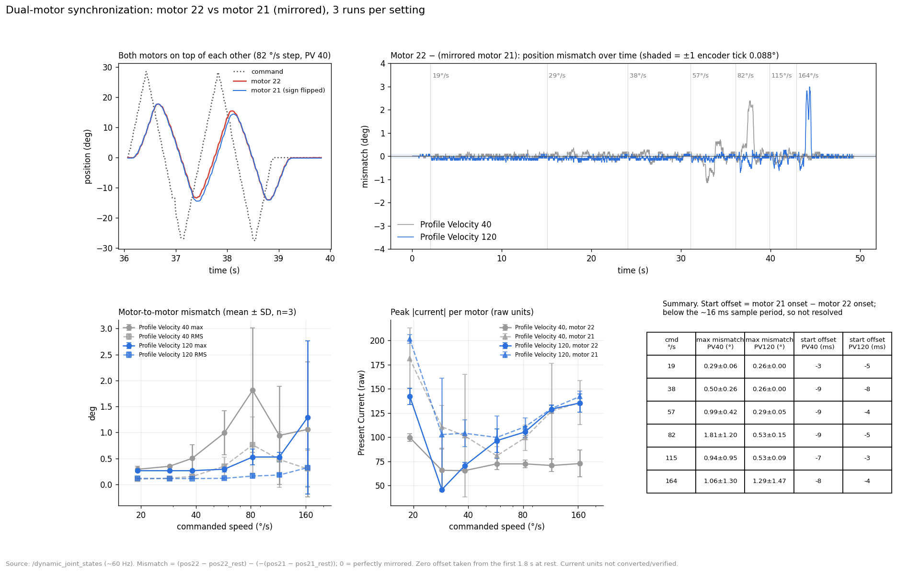
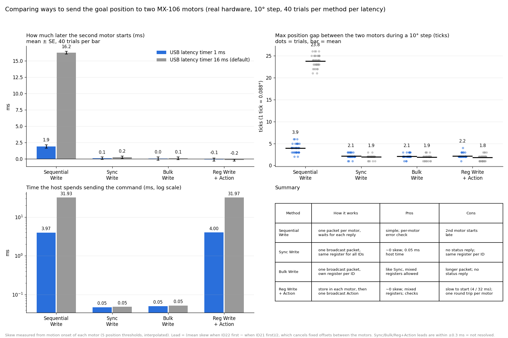

# Dual Motor Synchronization Test - ROS 2 Humble

Two Dynamixel MX106 motors (IDs 22 and 21) drive one joint (`dual_joint`) through ROS 2 control. This repository records an experiment on how closely the two motors stay in sync.

```
Motor 22 ┐
         ├─→ dual_joint   (mirrored: joint = 0.5·pos22 − 0.5·pos21)
Motor 21 ┘
```

## Questions

1. How far apart do the two motors get while moving?
2. Do they move at the same time?
3. How are they kept in sync, and what makes the sync better?
4. How do the ways of sending the goal to two motors (Write, Sync Write, Bulk Write, Reg Write + Action) differ, and which is best?

## Setup

- Linux machine, real motors on `/dev/ttyUSB0`, one controller container (Docker, ROS 2 Humble), controller update rate 50 Hz.
- Both motors get the same goal through the mirror matrices `1, -1` (command) and `0.5, -0.5` (state); same operating mode (3), current limit (400) and profile.
- Motion: `dual_joint` swung ±28.6° (±0.5 rad) with the commanded speed raised in 7 steps (19, 29, 38, 57, 82, 115, 164 °/s). Each step is a back-and-forth swing; the run is 49 s.
- Two settings, 3 runs each: `Profile Velocity` / `Profile Acceleration` = **40 / 20** (repo default) and **120 / 60**. The change was applied only on the test machine; the repo URDF still has 40 / 20.
- Per-motor position, velocity and current from `/dynamic_joint_states` (~60 Hz).
- **Mismatch** = `(pos22 − rest22) − (−(pos21 − rest21))`. 0 means perfectly mirrored. The zero offset is taken from the first 1.8 s at rest. One Dynamixel tick (1/4096 of a turn) is 0.088°.

## Results



Raw data: `docs/motorsync_pv{40,120}_r{1,2,3}.csv` (`t_s, ref_rad, joint_fb_rad, motor22_pos_rad, motor21_pos_rad, motor22_vel_rad_s, motor21_vel_rad_s, motor22_current, motor21_current`).

### 1. How far apart (max mismatch, mean ± SD of 3 runs)

| Commanded speed (°/s) | `Profile Velocity` 40 | `Profile Velocity` 120 |
|---|---|---|
| 19 | 0.29 ± 0.06° (3.3 ticks) | 0.26 ± 0.00° (3.0 ticks) |
| 38 | 0.50 ± 0.26° (5.7 ticks) | 0.26 ± 0.00° (3.0 ticks) |
| 57 | 0.99 ± 0.42° (11.3 ticks) | 0.29 ± 0.05° (3.3 ticks) |
| 82 | 1.81 ± 1.20° (20.6 ticks) | 0.53 ± 0.15° (6.0 ticks) |
| 115 | 0.94 ± 0.95° (10.7 ticks) | 0.53 ± 0.09° (6.0 ticks) |
| 164 | 1.06 ± 1.30° (12.1 ticks) | 1.29 ± 1.47° (14.7 ticks) |

- 1 Dynamixel tick = 360° / 4096 = 0.088°. At rest the mismatch is ≤ 0.1° (about 1 tick).
- RMS mismatch is 0.1–0.8° over the sweep.
- The mismatch comes in short bursts during acceleration and direction reversal and returns to ~0 afterwards.
- At 164 °/s the result changes a lot from run to run (SD ≈ 1.3–1.5°), so the two settings cannot be told apart there.

### 2. Simultaneity

- The cross-correlation lag between the two motors is 0 ms.
- The start-of-motion difference is about −3 to −9 ms (motor 21 slightly earlier). This is below the ~16 ms sample period, so the offset is small but not resolved.

### 3. Load sharing

- The peak current of motor 21 is usually higher than that of motor 22 (for example about 100 vs 66 at 29 °/s with `Profile Velocity` 40), so the load is shared unevenly. Current units were not converted or verified.

## How the motors are kept in step (checked in the code and config)

- Both goal positions go out in one `GroupSyncWrite` packet, so both motors receive the command at the same time.
- Both motors are read with one `GroupFastSyncRead`, so both positions come from the same bus cycle.
- Both are driven from the single `dual_joint` command through the mirror matrices, with identical settings.

## Write methods compared (research + real hardware)

### How each method works (Protocol 2.0)

Source: ROBOTIS e-Manual, [DYNAMIXEL Protocol 2.0](https://emanual.robotis.com/docs/en/dxl/protocol2/), and the Dynamixel SDK in this repository.

| Method | Instruction | How it works | Status reply | Same register for all IDs? |
|---|---|---|---|---|
| Sequential Write | `Write` (0x03), one per motor | Each motor runs its command as soon as its own packet arrives, so start times differ by the time spent on the earlier packets | one per motor | n/a |
| **Sync Write** | `Sync Write` (0x83), broadcast | One packet holds the data for every ID; every motor receives the same packet and runs its part on arrival | none | yes (same address and length) |
| **Bulk Write** | `Bulk Write` (0x93), broadcast | One packet; each ID has its own address and length (each ID once) | none | no |
| **Reg Write + Action** | `Reg Write` (0x04) per motor, then `Action` (0x05) broadcast | Reg Write stores the data in the motor and sets a flag (nothing moves). One Action then starts every stored command. Action without a stored Reg Write returns an Instruction Error (0x02) | Reg Write: one per motor; Action broadcast: none | no |

Sync Write does not store anything and wait for a trigger. All motors hear the same packet at the same moment, so they act together. "Store, then execute" is Reg Write + Action.

Packet sizes (computed, not measured; 2 motors, 4-byte Goal Position, 1 Mbps = 10 µs per byte): Sync Write 24 bytes (~0.24 ms), Bulk Write 28 bytes (~0.28 ms), Reg Write + Action 2 × 16 + 2 × 11 reply + 10 = 64 bytes (~0.64 ms plus 2 × the motor Return Delay Time of 500 µs).

The driver in this repository (`dynamixel_hardware_interface/src/dynamixel/dynamixel.cpp`) writes goals with `GroupSyncWrite` (one `txPacket()` per cycle) and reads with `GroupFastSyncRead`.

### Test on real hardware

Two MX-106 (model 321, firmware 45, Return Delay Time 250 = 500 µs, Status Return Level 2), 1 Mbps, Dynamixel SDK (Python) with no ROS running. Each trial sends a 10° mirrored step (114 ticks, `Profile Velocity` 120, `Profile Acceleration` 60) to both motors with one of the four methods. The order of the IDs inside the command alternates between trials. Both motors are polled with Sync Read and the start time of each is taken from five position thresholds (3–48 ticks) with interpolation. 40 trials per method, run at USB latency timer 16 ms (default) and 1 ms (set temporarily through sysfs, restored to 16 afterwards).



Script: [`scripts/write_method_test.py`](scripts/write_method_test.py). Raw data: `docs/writemethods_latency{1,16}ms.csv`.

**Lead** = how much later the second motor starts (mean over the 40 trials ± standard error; computed as (mean skew when ID 22 is first − mean skew when ID 21 is first) / 2, which cancels fixed offsets between the motors).

| Method | Lead @ 1 ms | Lead @ 16 ms | Max gap between motors @ 1 ms | Max gap @ 16 ms | Host time to send @ 1 ms / 16 ms |
|---|---|---|---|---|---|
| Sequential Write | 1.90 ± 0.25 ms | **16.25 ± 0.20 ms** | 3.9 ticks (0.34°), worst 6 | **23.8 ticks (2.1°), worst 26** | 3.97 / 31.93 ms |
| Sync Write | 0.09 ± 0.18 ms | 0.24 ± 0.19 ms | 2.1 ticks, worst 3 | 1.9 ticks, worst 3 | 0.05 / 0.05 ms |
| Bulk Write | 0.04 ± 0.26 ms | 0.08 ± 0.23 ms | 2.1 ticks, worst 3 | 1.9 ticks, worst 3 | 0.05 / 0.05 ms |
| Reg Write + Action | −0.10 ± 0.23 ms | −0.19 ± 0.16 ms | 2.2 ticks, worst 4 | 1.8 ticks, worst 3 | 4.00 / 31.97 ms |

"Max gap" is the largest difference between the two motors' displacement during the step, in Dynamixel ticks (1 tick = 0.088°). About 2 ticks of it is present even for the simultaneous methods (the two motors are read one after the other, about 0.6 ms apart, and have different friction), so 2 ticks is the floor of this setup.

### Pros and cons

| | Sequential Write | Sync Write | Bulk Write | Reg Write + Action |
|---|---|---|---|---|
| Starts both motors together | no (1.9 ms late at 1 ms latency, 16 ms late at 16 ms) | yes (within ±0.3 ms, not resolved) | yes (same) | yes (same) |
| Gap between motors in the test | 3.9 – 23.8 ticks | ~2 ticks | ~2 ticks | ~2 ticks |
| Time to send the command | 4 – 32 ms | 0.05 ms | 0.05 ms | 4 – 32 ms |
| Per-motor error confirmation | yes (status reply) | no (read back instead) | no | Reg Write yes; Action no |
| Different registers per motor | yes | no | yes | yes |
| Packets / bytes | most | fewest | few | most |
| Risk | slow, late motors | a lost packet moves none | same | slow to start |

### Conclusion

- For this robot (both motors get the same register, a Goal Position, every cycle) **Sync Write is the best choice**: the motors start together, the whole command takes 0.05 ms and the result does not depend on the USB latency timer.
- Bulk Write behaves the same and is only needed when the motors need different registers. Reg Write + Action also starts them together, but it needs a round trip per motor, so the motors only start 4 ms (1 ms latency timer) to 32 ms (16 ms latency timer) after the first call. That is a poor fit for a 50 Hz control loop at the default latency.
- Sequential Write is the one to avoid. At the default 16 ms latency timer the second motor starts 16 ms late, which is a gap of about 24 ticks (2.1°) during a 10° step. Lowering the latency timer to 1 ms reduces this to about 2 ms and 4 ticks, but does not remove it.
- The three simultaneous methods cannot be told apart by timing here: their leads are within ±0.3 ms, below what the ~3–16 ms polling can resolve.
- The mismatch seen under ROS (3–20 ticks, table above) comes from a different test (a speed sweep), so it cannot be compared directly. It is consistent with the driver using Sync Write: the write method alone would have given about 2 ticks, so the rest comes from the motors' own profile and load.

## What makes the sync better

Tested:
- Raising `Profile Velocity` / `Profile Acceleration` from 40 / 20 to 120 / 60 cut the max mismatch 2–3× at 38–115 °/s (0.99° → 0.29° at 57 °/s, 1.81° → 0.53° at 82 °/s).

Not tested yet:
- Calibrate the zero offset of the two motors so the mirrored positions start exactly equal.
- Use the time-based profile (Drive Mode) so both motors take the same time to reach each goal.
- Match the position PID gains and check the mechanical coupling for backlash (the current imbalance suggests uneven load).
- Raise the update rate. The USB latency timer (16 ms) limited the controller to 50 Hz; lowering it to 1 ms should allow more (the latency timer was only tested for the write methods above, not for the ROS controller rate).

## Limits of this test

- In the ROS sweep, samples are ~60 Hz, so timing differences below ~16 ms are not resolved (the write-method test polls at 3 ms and 16 ms).
- Only 3 runs per setting; the 164 °/s results are too variable to compare.
- `torque_state` in `/dynamixel_hardware_interface/dxl_state` read `false` for both motors during the moves; this was not checked against the torque-enable register.

## Reproduce

```bash
docker build -t duo-joint-humble -f Dockerfile.minimal .
docker run -it --rm --name duo --device=/dev/ttyUSB0:/dev/ttyUSB0 -v "$PWD":/ws -w /ws duo-joint-humble bash -c \
  'source /opt/ros/humble/setup.bash && colcon build --packages-select dynamixel_interfaces dynamixel_hardware_interface duo_joint && source install/setup.bash && ros2 launch duo_joint dual_motor_control.launch.py'
# second terminal: per-motor state while sending a JointTrajectory to /joint_trajectory_controller/joint_trajectory
docker exec -it duo bash -c 'source /opt/ros/humble/setup.bash && ros2 topic echo /dynamic_joint_states'
```

Run only one controller at a time: a second process on the same serial port freezes the feedback. Docker Desktop on macOS cannot pass through serial devices; run on Linux.
