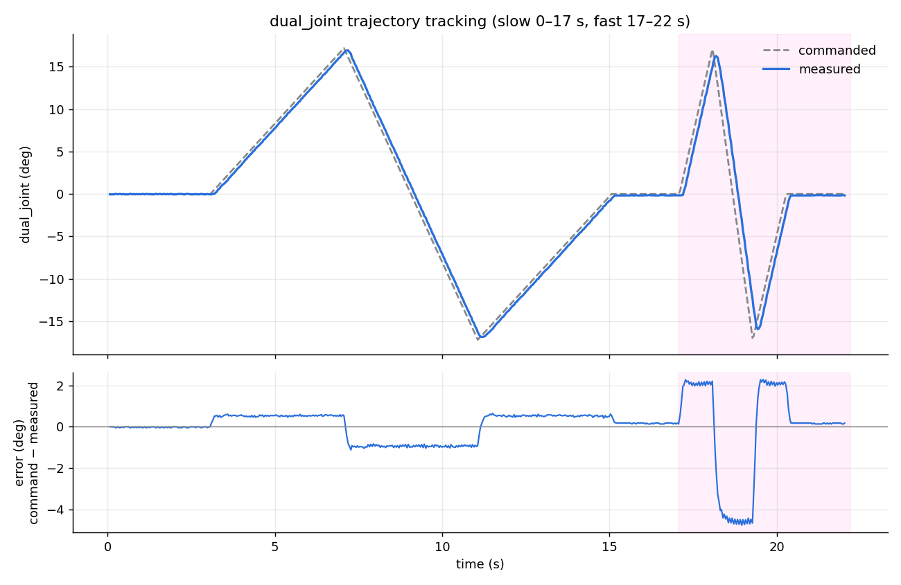
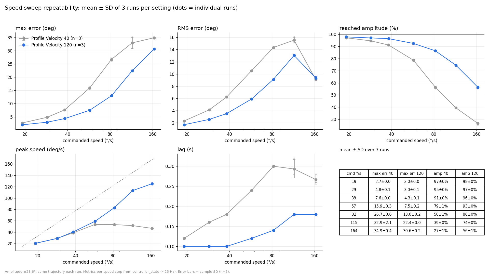

# Dual Motor Joint Control - ROS 2 Humble

Synchronized dual Dynamixel motors (MX106) on a single joint using ROS 2 Humble and Docker.

## Hardware Setup

```
Motor 22 (MX106) ┐
                  ├─→ dual_joint (synchronized)
Motor 21 (MX106) ┘
```

**Performance:**
- Single Motor: 6 Nm
- Dual Motors: ~12 Nm (2×)

---

## Quick Start (Linux with USB adapter)

```bash
docker build -t duo-joint-humble -f Dockerfile.minimal .
./quick_test.sh        # builds, launches, prints controller + motor state
```

Motors are mirrored (matrices `1, -1` / `0.5, -0.5`), torque on, current limit 400, slow profile.
Update rate is 50 Hz: at 100 Hz the USB latency timer (16 ms) causes read failures.
Docker Desktop on macOS cannot pass through serial devices; run on Linux.

---

## Hardware Test Results

Tested on the Linux machine with the real motors on `/dev/ttyUSB0` (IDs 22 and 21), single controller container, update rate 50 Hz. A small trajectory was sent to `dual_joint` and the commanded (`reference`) and measured (`feedback`) positions were recorded from `/joint_trajectory_controller/controller_state`.



Raw data: [`docs/trajectory_test.csv`](docs/trajectory_test.csv) (`t_s, reference_rad, feedback_rad, error_rad, velocity_rad_s`).

| Segment | Trajectory | Max error | RMS error | Peak joint speed |
|---|---|---|---|---|
| Rest (0–3 s) | hold 0 | 0.05° | 0.03° | 0 |
| Slow (3–17 s) | 0 → +17° → −17° → 0 over 12 s | 1.1° | 0.64° | ~10°/s |
| Fast (17–22 s) | 0 → +17° → −17° → 0 over 3.2 s | 4.8° | 2.5° | ~29°/s |

**Findings**
- Both motors are detected (`comm_state: 0`, hardware error flags 0) and both controllers (`joint_trajectory_controller`, `joint_state_broadcaster`) go active.
- The joint follows the command, but it lags behind it. The error grows with speed (about 1° at ~10°/s, about 4.8° at ~29°/s) and returns to ~0.2° once the joint stops. The fast move also stops short of the peaks (about 16° instead of 17°). This looks like the motor profile limiting speed (`Profile Velocity` 40, `Profile Acceleration` 20) rather than noise. Raise those values or slow the trajectory to reduce the lag.
- At rest the position is stable to within one encoder tick (0.088°).

**Known issues**
- `/dynamixel_hardware_interface/dxl_state` reports `torque_state: false` for both motors even while they follow the command. Not yet checked against the torque-enable register, so treat it as unverified.
- One `SYNC_READ_FAIL` (`FastSyncRead Rx Fail`, error -3001) was logged at start-up; it was not seen to repeat during the moves in this run.
- Only one process may use the serial port. Starting a second controller container while one is running makes the feedback freeze (observed: feedback stuck while the command moved).

**Reproduce**
```bash
# terminal 1: keep the controller running
docker run -it --rm --name duo --device=/dev/ttyUSB0:/dev/ttyUSB0 -v "$PWD":/ws -w /ws duo-joint-humble bash -c \
  'source /opt/ros/humble/setup.bash && colcon build --packages-select dynamixel_interfaces dynamixel_hardware_interface duo_joint && source install/setup.bash && ros2 launch duo_joint dual_motor_control.launch.py'

# terminal 2: send a trajectory inside the same container
docker exec -it duo bash -c 'source /opt/ros/humble/setup.bash && source /ws/install/setup.bash && ros2 topic pub --once /joint_trajectory_controller/joint_trajectory trajectory_msgs/msg/JointTrajectory \
  "{joint_names: [dual_joint], points: [{positions: [0.3], time_from_start: {sec: 4}}, {positions: [-0.3], time_from_start: {sec: 8}}, {positions: [0.0], time_from_start: {sec: 12}}]}"'
```

### Speed sweep (Profile Velocity 40 vs 120)

The joint was swung ±28.6° with the commanded speed raised in 7 steps (19 → 164 °/s), 3 runs per setting. `Profile Velocity`/`Profile Acceleration` were changed on the robot copy only for this test; the repo URDF still has 40 / 20.



Single-run detail: [`docs/speed_sweep.png`](docs/speed_sweep.png), before/after overlay: [`docs/speed_sweep_compare.png`](docs/speed_sweep_compare.png). Raw data: `docs/sweep_pv40_r{1,2,3}.csv`, `docs/sweep_pv120_r{1,2,3}.csv`.

| Commanded (°/s) | Max error, PV 40 | Max error, PV 120 | Reached amplitude, PV 40 | Reached amplitude, PV 120 |
|---|---|---|---|---|
| 19 | 2.7 ± 0.0° | 2.0 ± 0.0° | 97% | 98% |
| 38 | 7.6 ± 0.0° | 4.3 ± 0.1° | 91% | 96% |
| 57 | 15.9 ± 0.3° | 7.5 ± 0.2° | 79% | 93% |
| 82 | 26.7 ± 0.6° | 13.0 ± 0.2° | 56% | 86% |
| 115 | 32.9 ± 2.1° | 22.4 ± 0.0° | 39% | 74% |
| 164 | 34.9 ± 0.4° | 30.6 ± 0.2° | 27% | 56% |

(mean ± SD, n = 3; the runs are very repeatable.)

**Findings**
- With `Profile Velocity` 40 the measured speed saturates at ~54 °/s; any faster command only adds lag (0.12 → 0.30 s) and the joint falls short of the target amplitude (down to 27%).
- With `Profile Velocity` 120 / `Profile Acceleration` 60 the joint follows up to ~113 °/s, lag stays at 0.10–0.18 s and the error is roughly halved between 57 and 82 °/s.
- At 164 °/s it still falls short (56% amplitude, 30.6° error). The cause is not isolated (possibly acceleration or controller response).
- Whether 120 corresponds to ~165 °/s assumes 1 unit = 0.229 rpm; this was not verified for the installed motor model.
- Raising the profile means faster, harder motion: check the mechanical limits before using it.

---

## Files

- `Dockerfile` - Full ROS 2 desktop
- `Dockerfile.minimal` - Faster build
- `docker-compose.yml` - Container management
- `quick_test.sh` - Build, launch and status check
- `duo_joint/` - ROS 2 package

---

**Status:** ✅ Ready for hardware testing

**GitHub:** https://github.com/NapatzZ/duo-joint-control
